  

 

  
  

<h1 align="center">hey there 👋</h1>

### 👨‍💻 About Me

Hi, I'm **Abhishek Das**.

- 🔭 I'm working as a **Product Security Architect**, with 10 years securing AI, mobile, embedded and cloud systems
- 🛡️ I design secure-by-design architectures and write the security scripts and tooling that enforce them
- 📚 I'm currently learning **LLM and AI agent security**
- ⚡ In my free time I tinker with hardware, play CTFs, read, travel and play guitar
- 💬 Ask me about **threat modeling, secure architecture, and embedded or mobile security**

### 🛡️ Security Architect

I architect security for products end to end, from silicon to cloud, and write the code that enforces it.

**Core skills**

| Area | What I do |
| --- | --- |
| 🧩 **Secure architecture** | Secure-by-design, zero trust, defense in depth, security reference architectures |
| 🎯 **Threat modeling and risk** | STRIDE, attack trees, data flow analysis, risk assessment, security requirements |
| 🤖 **AI and LLM security** | Prompt injection, model and data supply chain, agent guardrails, AI threat modeling |
| 📱 **Mobile security** | Android and iOS app hardening, secure storage, platform security, mobile pentesting |
| 🔌 **Embedded and firmware security** | Secure boot, firmware analysis, hardware root of trust, device hardening |
| ☁️ **Cloud and container security** | IAM design, secrets management, Kubernetes and Docker hardening, infrastructure as code security |
| 🔐 **Cryptography and key management** | TLS, PKI, encryption at rest and in transit, key lifecycle design |
| 🔁 **DevSecOps** | Security automation in CI/CD, SAST, DAST, SCA, SBOM, and supply chain security |

**Cyber security tools**

**Code and dependency analysis**

  
  
  
  
  

**Reverse engineering and firmware**

  
  
  
  
  

**Application and mobile testing**

  
  
  
  

**Network and traffic analysis**

  
  
  

**Fuzzing**

  
  
  

**Cloud and infrastructure security**

  
  
  
  

**Frameworks and standards**

  
  
  
  
  

> These skills and tools are my best guess from your background, so edit the lists to match what you actually use.

### 🛠 Languages and Tools

  
  
  
  
  
  
  
  
  
  
  
  
  

### 🔥 My Stats

<!-- Replace YOUR-GITHUB-USERNAME with your actual GitHub username -->

  
  

  

